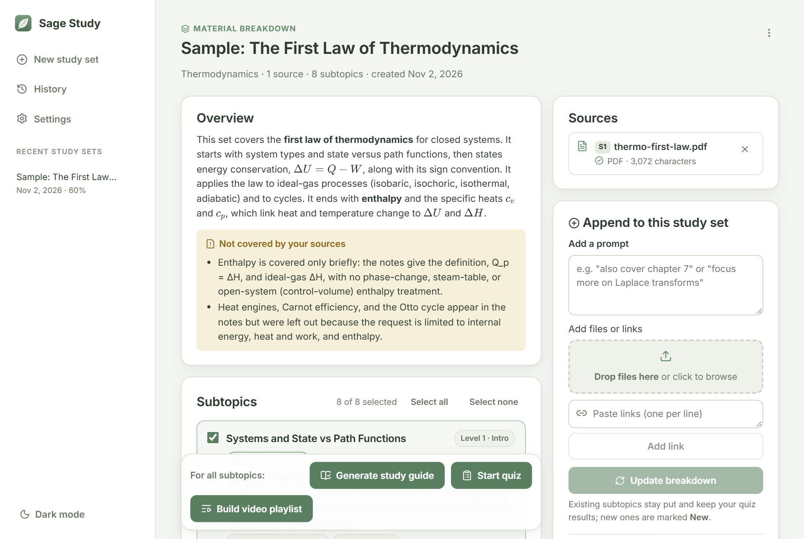
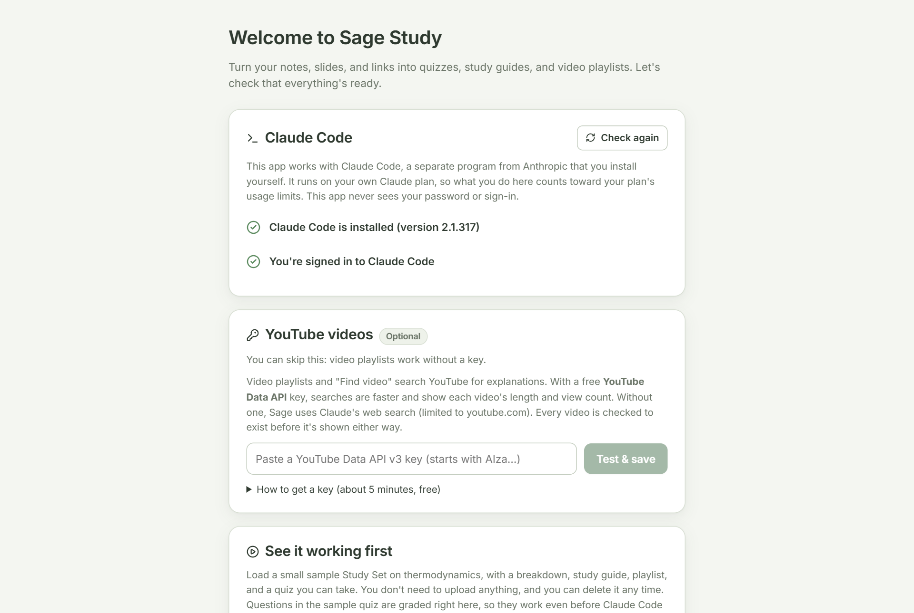
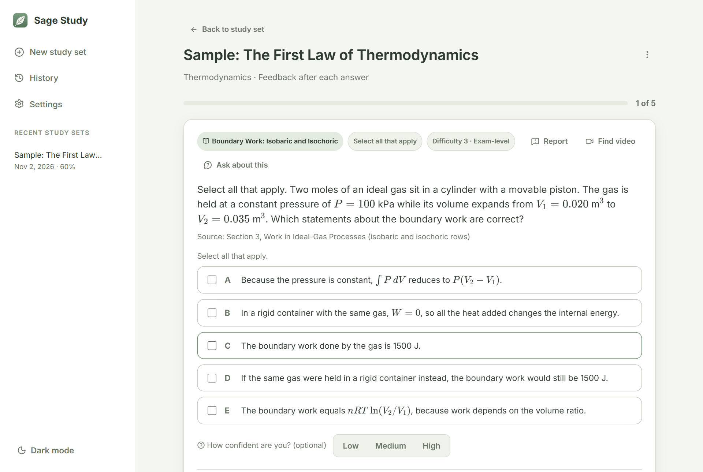
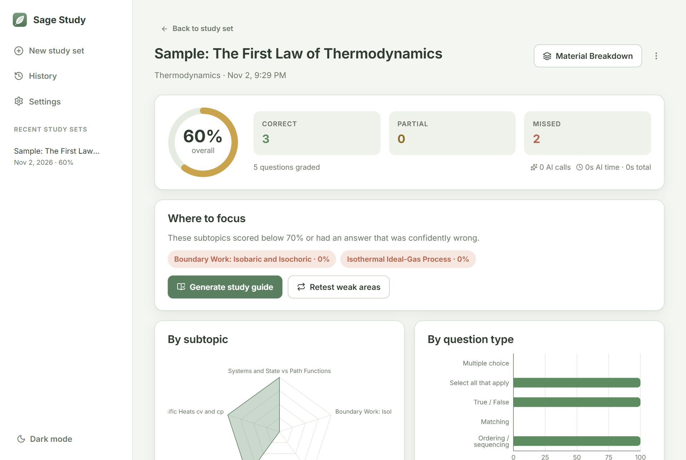
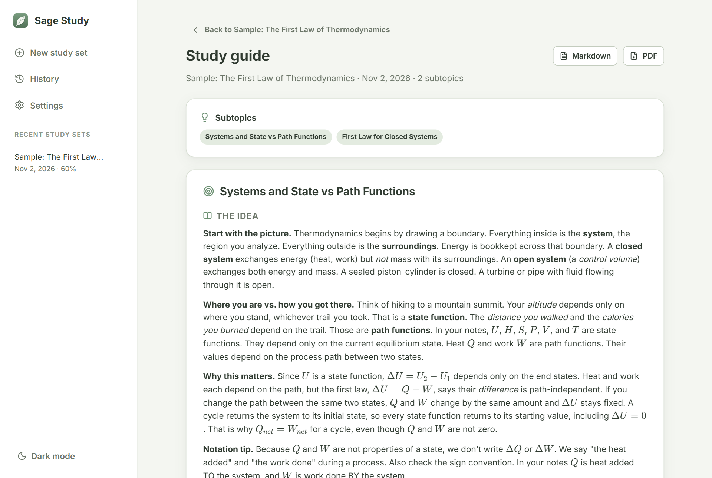
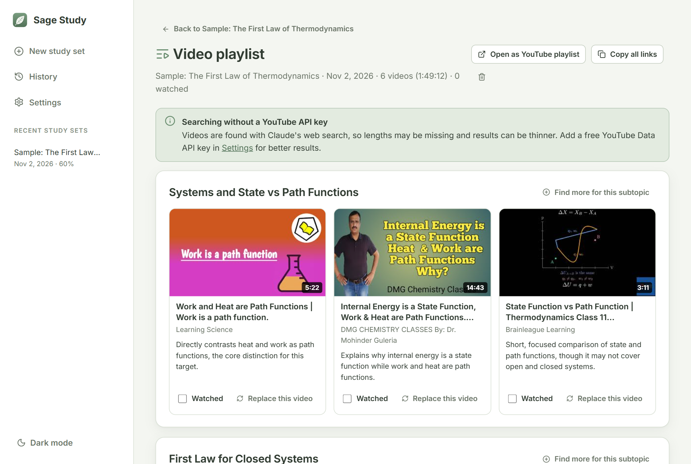
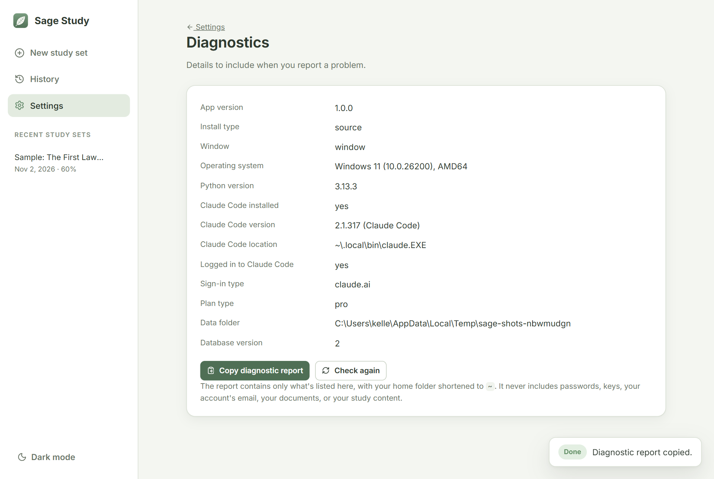

# Sage Study

Turn your notes, slides, and links into quizzes, study guides, and video playlists. Sage Study is a desktop app that **works with Claude Code**, using your own Claude account.

> **Unofficial.** Sage Study isn't affiliated with or endorsed by Anthropic. "Claude" and "Claude Code" are Anthropic's trademarks.

<p align="center"></p>

## What you need

- **Claude Code**, installed by you from Anthropic: [install instructions](https://code.claude.com/docs/en/setup).
- **A Claude plan that includes Claude Code.** The free plan doesn't. See [Anthropic's list of plans](https://code.claude.com/docs/en/setup#authenticate).
- Windows 10 or newer, macOS 13 or newer, or Linux (best-effort).

Everything you do in the app counts against **your own plan's usage limits**. It's for personal use.

Before you use it, please know that Anthropic restricts how Claude subscriptions may be used with third-party software, and that those rules apply to your account. Read [Anthropic's authentication and credential-use terms](https://code.claude.com/docs/en/legal-and-compliance#authentication-and-credential-use) and decide for yourself. This project doesn't claim Anthropic has approved it.

## Install

Non-technical? [INSTALL.md](INSTALL.md) is a one-page guide you can follow, or send to a friend.

**Windows**
1. Click the green **Code** button on this page, then **Download ZIP**, and unzip it.
2. Double-click **Install.bat**. If Windows warns you, click **More info**, then **Run anyway**.
3. Open **Sage Study** from your Desktop.

**macOS**
1. Open Terminal (press Cmd+Space, type Terminal, press Return).
2. Paste this line and press Return: `curl -fsSL https://raw.githubusercontent.com/kfcasey7/sage-study/main/install.sh | sh`
3. Open **Sage Study** from your Desktop or Applications.

**Linux**
1. Open a terminal.
2. Run `curl -fsSL https://raw.githubusercontent.com/kfcasey7/sage-study/main/install.sh | sh`
3. Open **Sage Study** from your applications menu. It opens in your browser unless a desktop window library is available.

Prefer a regular download? The [Releases page](https://github.com/kfcasey7/sage-study/releases) has a Windows installer, a Mac app, and a Linux tarball. They aren't code-signed, so read [why your computer warns you](#why-does-windows-or-macos-warn-me).

If you're technical: `uv tool install git+https://github.com/kfcasey7/sage-study`, then run `sage-study`.

When the app first opens, a short setup checks Claude Code and offers a demo you can try without uploading anything.

<p align="center"></p>

## What it does

- **Study Sets:** add files (PDF, Word, PowerPoint, text, photos of notes) and links (web pages, PDF links, YouTube videos, public Google Docs, Slides, and Sheets).
- **Material Breakdown:** an overview, subtopics with key concepts and formulas, a map of how they relate, and notes on anything your sources don't cover. Pick subtopics, then make a study guide, a quiz, or a playlist.
- **Quizzes:** 13 question types, including math with step-by-step work and code in a real editor. Difficulty levels, an adaptive mode, and confidence ratings. Objective questions are graded on your computer; written answers are graded by Claude against a rubric.
- **Results and study guides:** scores by subtopic, your weak areas, and a personal guide with worked examples, diagrams, your specific mistakes, and practice questions. Export to PDF or Markdown.
- **Video playlists:** YouTube explanations for each subtopic. Every video comes from a real search and is checked to exist.
- **History:** your sets, mastery trends by subject, and one-click retests of weak areas.

<p align="center">
  
  
</p>
<p align="center">
  
  
</p>

## Where your data goes

| What | Where it goes |
|---|---|
| Your study content, when you use an AI feature | To Anthropic, through **your own** Claude Code and account, under your agreement with Anthropic |
| Links you paste | The app fetches those pages directly from the sites they're on. YouTube links also read the video's transcript from YouTube |
| Video searches | With a YouTube key, to Google's YouTube API. Without one, through Claude Code's web search |
| Video playback and checks | The player loads from YouTube; each video is checked with YouTube's public lookup |
| Update checks | A request to GitHub for the newest version number. You can turn this off in Settings |
| **Everything else** | **Stays on your computer.** There's no account, server, analytics, or tracking |

## FAQ

### Do I need a paid plan?
Yes. You need a Claude plan that includes Claude Code, and the free plan doesn't. A YouTube key is optional and free. The app itself is free. Your use counts against your plan's limits, so a quiz or guide can use up part of your allowance.

### Where is my data?
In a folder on your computer, separate from the app. **Settings** shows the exact location.

- Windows: `%LOCALAPPDATA%\SageStudy`
- macOS: `~/Library/Application Support/SageStudy`
- Linux: `~/.local/share/SageStudy`

To keep it somewhere else, run the app with `--data-dir <folder>`.

### How do I update?
When a new version is out, a small banner appears with what's new and an update button. Nothing updates until you click. You can also use **Settings > Updates > Check for updates**, or run the installer from a newer download. Your study data is kept.

### How do I uninstall?
- **Windows:** Start Menu > **Uninstall Sage Study**, or double-click `Uninstall.bat`. If you used the Setup download, use Windows' **Installed apps** list.
- **macOS:** double-click `Uninstall.command`, or run `sh ~/Library/Application\ Support/SageStudy-App/uninstall.sh`. If you used the downloaded app, drag it to the Trash.
- **Linux:** run `sh ~/.local/share/sage-study-app/uninstall.sh`. If you used the tarball, delete its folder.

The uninstallers ask before deleting your study data. They don't touch Claude Code. With a downloaded Mac app or Linux tarball, your data stays in the folder listed above until you delete it.

### Why does Windows or macOS warn me?
Sage Study isn't code-signed, because signing certificates cost money, so your computer can't check who published it. These warnings **will** appear. Only continue if you got the app from this project's page and trust it.

**Windows (SmartScreen):** you may see a blue box saying "Windows protected your PC", with only a **Don't run** button. Click **More info**, and a **Run anyway** button appears. Click that.

**macOS (Gatekeeper):** the Mac says it can't verify the app, and offers only **Done** or **Move to Trash**. Choose **Done**. Then open **System Settings > Privacy & Security**, scroll down to **Security**, click **Open Anyway** next to the message about the app, and confirm with **Open**. You only need to do this once ([Apple's instructions](https://support.apple.com/en-us/102445)). The Terminal install above avoids this, because the Terminal doesn't mark what it downloads.

### Is this made by Anthropic?
No. It's an unofficial personal project that uses Claude Code, which you install separately.

## Troubleshooting

Start with **Settings > Help > Diagnostics**. Its report is safe to share, and it contains no passwords, keys, documents, or study content.

<p align="center"></p>

| Problem | What to do |
|---|---|
| "Claude Code not found" | Follow [Anthropic's install instructions](https://code.claude.com/docs/en/setup), then click **Check again**. If you just installed it, restart the app |
| "Claude Code isn't logged in" | Open a terminal, type `claude`, and follow the steps to sign in. Then click **Check again** |
| "Usage limit reached" | That's your Claude plan's limit. Your progress is saved, so come back after it resets |
| A link couldn't be read | It may need a login, or load only with JavaScript. Save the page as a PDF and upload that instead. For Google files, share as "Anyone with the link" |
| No internet | AI features and links need a connection. Your saved work still opens |
| The app opened in my browser | Its own window couldn't start. Everything still works. On Windows, installing Microsoft's [WebView2 Runtime](https://developer.microsoft.com/microsoft-edge/webview2/) usually fixes this |
| The installer fails | Check your internet connection and run it again, which is safe. Antivirus software sometimes blocks downloads, so try pausing it |
| Nothing opens | Look at `sage.log` in your data folder, and include the end of it in a [bug report](https://github.com/kfcasey7/sage-study/issues/new/choose) after checking it for anything private |

## Development

See [CONTRIBUTING.md](CONTRIBUTING.md) for setup and rules.

```bash
uv sync --group dev
uv run pytest                          # tests, with Claude Code mocked
uv run sage-study                      # run the app from your checkout

# UI work: the backend without a window (no launch token), then Vite with hot reload
cd backend && SAGE_FAKE_CLAUDE=1 uv run python -m sage.dev     # canned responses, no Claude Code calls
cd frontend && npm install && npm run dev

python scripts/build_frontend.py       # rebuild the UI that ships in backend/sage/web
python scripts/smoke_install.py        # the full installer cycle in a throwaway folder
python scripts/build_demo.py           # regenerate the demo set (uses your plan)
```

```
backend/sage/
  cli.py          command-line entry point (--data-dir, --check, --smoke-test)
  main.py         desktop startup: single instance, server thread, window or browser
  app.py          FastAPI app and the local-only guard
  llm_client.py   the only AI entry point: runs `claude -p` locked down, validates JSON, retries
  shortcuts.py    desktop and app-menu shortcuts
  migrations.py   versioned data migrations, with a backup first
  prompts/        every prompt sent to Claude
  services/       generation, grading, study guides, sources, YouTube, demo, updates
  web/            the prebuilt UI (generated)
frontend/src/     the React UI
installer/        the Windows installer's PowerShell scripts and the updaters
packaging/        PyInstaller and Inno Setup recipes for the release downloads
```

**How AI calls work.** Each request runs `claude -p` with JSON output, a schema, and a timeout. `ANTHROPIC_*` and third-party-provider variables are removed from its environment. `--tools ""`, `--restricted`, `--strict-mcp-config`, and `--setting-sources ""` turn off shells, file tools, MCP servers, your settings, and hooks. See [SECURITY.md](SECURITY.md).

## License

[MIT](LICENSE). Third-party licenses, including KaTeX, Monaco, Mermaid, and Recharts, are in [THIRD_PARTY_NOTICES.md](THIRD_PARTY_NOTICES.md).
